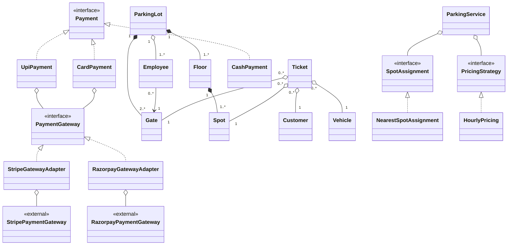
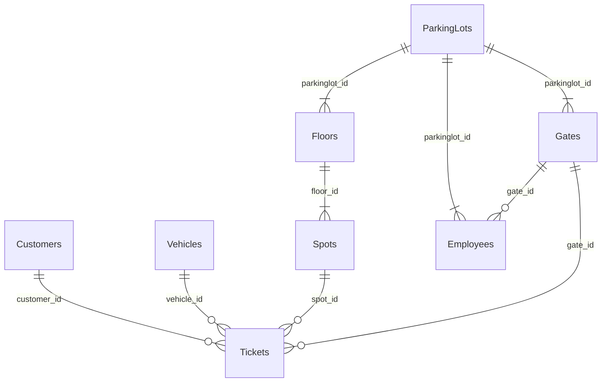

# LLD Problem: Design Parking Lot

Click any row with an arrow to expand or collapse it.

- S0 - Problem Statement Understanding
- S1 - Requirement Gathering
- S2 - Clarify Requirements
- S3 - Class Diagram [Classes, Relation b/w classes, Design Patterns]
- S4 - Schema Design [Tables, PK & FK, Cardinalities]

## S0 - Problem Statement Understanding

Parking Lot system with which customer can park their vehicle.

## S1 - Requirement Gathering

1. Each customer get Parking ticket at entry gate.
2. Employee generate ticket at entry gate.
3. Parking spot can be of Bike, Car type.
4. Customer pay at the time of exit at Exit gate.
5. Parking Lot have multiple floors.
6. Each Floor has multiple spots.
7. Parking lot has multiple Entry and Exit gate.

## S2 - Clarify Requirements

<details open>
<summary><b>A. Actors</b></summary>

1. **Customer:** brings vehicle, receives ticket, pays at exit.
2. **Employee:** generates ticket at entry gate, collects payment at exit gate.
3. **Admin:** configures floors/spots and marks spots for maintenance.

</details>

<details open>
<summary><b>B. Core Flows</b></summary>

1. **Entry:** Employee enters vehicle no. & type at entry gate -> system assigns nearest available matching spot -> ticket generated.
2. **Exit:** Employee scans ticket at exit gate -> fee calculated -> customer pays -> ticket marked PAID -> spot marked FREE.

</details>

<details open>
<summary><b>C. Key Concepts & Variations</b></summary>

1. **Vehicle types:** Bike, Car (extensible to Truck etc.).
2. **Spot types:** Bike, Car (extensible); floors and spots configured by admin.
3. **Gate types:** Entry, Exit; multiple of each.
4. **Ticket contains:** ticket id, entry time, vehicle no., vehicle type, floor number, spot number, entry gate.
5. **Payment modes:** CASH, CARD, UPI.

</details>

<details open>
<summary><b>D. Business Rules</b></summary>

1. Vehicle parks only in a spot of matching type (Bike can't use Car spot).
2. Assign the nearest available spot to the entry gate.
3. Pricing: hourly rate per vehicle type; partial hour rounded up.
4. Spot is freed only after payment succeeds.
5. A vehicle can't have two active tickets at the same time.

</details>

<details open>
<summary><b>E. States</b></summary>

1. **Spot:** FREE, OCCUPIED, MAINTENANCE.
2. **Ticket:** ACTIVE, PAID.

</details>

<details open>
<summary><b>F. Edge Cases & Failures</b></summary>

1. No matching spot available -> parking full, no ticket generated.
2. Lost ticket -> employee looks up latest ACTIVE ticket by vehicle no. and charges fee (+ lost-ticket penalty).
3. Payment fails -> ticket stays ACTIVE, vehicle can't exit; retry or change payment mode.
4. Spot under maintenance -> never assigned.

</details>

<details open>
<summary><b>G. Non-Functional Requirements</b></summary>

1. **Concurrency:** two gates must never assign the same spot at the same time (one spot holds at most one vehicle).
2. **Extensibility:** add new vehicle types, spot-assignment strategies, pricing rules, or payment modes without modifying existing code.

</details>

<details open>
<summary><b>H. Out of Scope</b></summary>

1. Advance reservations
2. Discounts
3. EV charging
4. Monthly passes
5. Multiple parking lots

</details>

## S3 - Class Diagram [Classes, Relationship, Design Patterns]

<details open>
<summary><b>Classes, enums and interfaces</b></summary>

**Classes**

- Customer
- Ticket
- Gate
- Employee
- Spot
- Vehicle
- Floor
- ParkingLot
- ParkingService
- NearestSpotAssignment
- HourlyPricing
- StripeGatewayAdapter
- RazorpayGatewayAdapter
- CashPayment
- CardPayment
- UpiPayment

**Enums**

- SpotStatus
- VehicleType
- TicketStatus
- GateType

**Interfaces**

- PricingStrategy
- SpotAssignment
- Payment
- PaymentGateway

</details>

<details open>
<summary><b>Overview</b></summary>



</details>

### Domain classes

<details>
<summary><b>ParkingLot</b></summary>

- `id : Integer`
- `name : String`
- `floors : List<Floor>`
- `entryGates : List<Gate>`
- `exitGates : List<Gate>`
- `employees : List<Employee>`

</details>

<details>
<summary><b>Floor</b></summary>

- `id : Integer`
- `name : String`
- `spots : List<Spot>`

</details>

<details>
<summary><b>Spot</b></summary>

- `id : Integer`
- `type : VehicleType`
- `status : SpotStatus`
- `vehicle : Vehicle`
- `floor : Floor`

</details>

<details>
<summary><b>Gate</b></summary>

- `id : Integer`
- `name : String`
- `type : GateType`

</details>

<details>
<summary><b>Employee</b></summary>

- `id : Integer`
- `name : String`
- `contact : String`
- `gate : Gate`

</details>

<details>
<summary><b>Customer</b></summary>

- `id : Integer`
- `name : String`

</details>

<details>
<summary><b>Vehicle</b></summary>

- `id : Integer`
- `number : String`
- `type : VehicleType`

</details>

<details>
<summary><b>Ticket</b></summary>

- `id : Integer`
- `entryTime : LocalDateTime`
- `entryGate : Gate`
- `vehicle : Vehicle`
- `customer : Customer`
- `spot : Spot`
- `amount : Integer`
- `status : TicketStatus`
- `exitTime : LocalDateTime`
- `issuedBy : Employee`
- `settledBy : Employee`

</details>

### Service

<details>
<summary><b>ParkingService</b></summary>

- `assignment : SpotAssignment`
- `pricing : PricingStrategy`
- `parkVehicle(vehicle : Vehicle, gate : Gate) : Ticket`
- `exitVehicle(ticket : Ticket, payment : Payment) : boolean`

</details>

### Spot assignment

<details>
<summary><b>SpotAssignment</b> (interface)</summary>

- `Spot assignSpot(gate : Gate, type : VehicleType)`

</details>

<details>
<summary><b>NearestSpotAssignment</b> (implements SpotAssignment)</summary>

- `Spot assignSpot(gate : Gate, type : VehicleType)`

</details>

### Pricing

<details>
<summary><b>PricingStrategy</b> (interface)</summary>

- `calculateFee(ticket : Ticket)`

</details>

<details>
<summary><b>HourlyPricing</b> (implements PricingStrategy)</summary>

- `calculateFee(ticket : Ticket)`

</details>

### Payment

<details>
<summary><b>Payment</b> (interface)</summary>

- `pay(customer : Customer, amount : Integer) : boolean`

</details>

<details>
<summary><b>CashPayment</b> (implements Payment)</summary>

- `pay(customer : Customer, amount : Integer) : boolean`

</details>

<details>
<summary><b>UpiPayment</b> (implements Payment)</summary>

- `payGateway : PaymentGateway`
- `pay(customer : Customer, amount : Integer) : boolean`

</details>

<details>
<summary><b>CardPayment</b> (implements Payment)</summary>

- `payGateway : PaymentGateway`
- `pay(customer : Customer, amount : Integer) : boolean`

</details>

### Payment gateways

<details>
<summary><b>PaymentGateway</b> (interface)</summary>

- `pay(countryCode : String, amount : Integer) : boolean`

</details>

<details>
<summary><b>StripeGatewayAdapter</b> (implements PaymentGateway)</summary>

- `gateway : StripePaymentGateway`
- `pay(countryCode : String, amount : Integer) : boolean`

</details>

<details>
<summary><b>RazorpayGatewayAdapter</b> (implements PaymentGateway)</summary>

- `gateway : RazorpayPaymentGateway`
- `pay(countryCode : String, amount : Integer) : boolean`

</details>

<details>
<summary><b>StripePaymentGateway</b> (external)</summary>

- `pay(amount : Integer, country : String)`

</details>

<details>
<summary><b>RazorpayPaymentGateway</b> (external)</summary>

- `paying(countryCode : String, amount : Integer)`

</details>

### Enums

<details>
<summary><b>VehicleType</b></summary>

- `BIKE`
- `CAR`

</details>

<details>
<summary><b>SpotStatus</b></summary>

- `FREE`
- `OCCUPIED`
- `MAINTENANCE`

</details>

<details>
<summary><b>TicketStatus</b></summary>

- `ACTIVE`
- `PAID`

</details>

<details>
<summary><b>GateType</b></summary>

- `ENTRY`
- `EXIT`

</details>

### Design patterns

<details>
<summary><b>Strategy</b></summary>

Assigning a spot to a customer uses the `NearestSpotAssignment` strategy. The bill is calculated using the `HourlyPricing` strategy of `PricingStrategy`.

</details>

<details>
<summary><b>Adapter</b></summary>

`StripeGatewayAdapter` and `RazorpayGatewayAdapter` connect the app's `PaymentGateway` to third-party payment gateways (e.g. Stripe and Razorpay).

</details>

<details>
<summary><b>Facade</b></summary>

The orchestration class `ParkingService` handles ticket generation at the entry gate, spot assignment, bill calculation and payment at the exit gate, and finally marks the occupied spot as `FREE`.

</details>

## S4 - Schema Design [Tables, PK, FK, Cardinality]

<details open>
<summary><b>Overview</b></summary>



</details>

### Tables

<details>
<summary><b>1. Customers</b></summary>

| Key | Column | Type    | References |
|-----|--------|---------|------------|
| PK  | `id`   | BIGINT  |            |
|     | `name` | VARCHAR |            |

</details>

<details>
<summary><b>2. Vehicles</b></summary>

| Key | Column   | Type    | References |
|-----|----------|---------|------------|
| PK  | `id`     | BIGINT  |            |
|     | `number` | VARCHAR |            |
|     | `type`   | TINYINT |            |

Constraint: `UNIQUE(number)`

</details>

<details>
<summary><b>3. ParkingLots</b></summary>

| Key | Column | Type    | References |
|-----|--------|---------|------------|
| PK  | `id`   | INT     |            |
|     | `name` | VARCHAR |            |

</details>

<details>
<summary><b>4. Floors</b></summary>

| Key | Column          | Type    | References        |
|-----|-----------------|---------|-------------------|
| PK  | `id`            | BIGINT  |                   |
|     | `number`        | VARCHAR |                   |
| FK  | `parkinglot_id` | BIGINT  | `ParkingLots(id)` |

</details>

<details>
<summary><b>5. Spots</b></summary>

| Key | Column     | Type    | References   |
|-----|------------|---------|--------------|
| PK  | `id`       | BIGINT  |              |
|     | `number`   | VARCHAR |              |
|     | `type`     | TINYINT |              |
|     | `status`   | INT     |              |
| FK  | `floor_id` | BIGINT  | `Floors(id)` |

Constraint: `UNIQUE(floor_id, number)`

</details>

<details>
<summary><b>6. Gates</b></summary>

| Key | Column          | Type    | References        |
|-----|-----------------|---------|-------------------|
| PK  | `id`            | BIGINT  |                   |
|     | `name`          | VARCHAR |                   |
|     | `gate_type`     | TINYINT |                   |
| FK  | `parkinglot_id` | BIGINT  | `ParkingLots(id)` |

</details>

<details>
<summary><b>7. Employees</b></summary>

| Key | Column          | Type    | References        |
|-----|-----------------|---------|-------------------|
| PK  | `id`            | BIGINT  |                   |
|     | `name`          | VARCHAR |                   |
|     | `contact`       | VARCHAR |                   |
| FK  | `parkinglot_id` | BIGINT  | `ParkingLots(id)` |
| FK  | `gate_id`       | BIGINT  | `Gates(id)`       |

</details>

<details>
<summary><b>8. Tickets</b></summary>

| Key | Column        | Type     | References      |
|-----|---------------|----------|-----------------|
| PK  | `id`          | BIGINT   |                 |
|     | `entry_time`  | DATETIME |                 |
|     | `exit_time`   | DATETIME |                 |
|     | `amount`      | BIGINT   |                 |
|     | `status`      | TINYINT  |                 |
| FK  | `customer_id` | BIGINT   | `Customers(id)` |
| FK  | `vehicle_id`  | BIGINT   | `Vehicles(id)`  |
| FK  | `spot_id`     | BIGINT   | `Spots(id)`     |
| FK  | `gate_id`     | BIGINT   | `Gates(id)`     |
| FK  | `issued_by`   | BIGINT   | `Employees(id)` |
| FK  | `settled_by`  | BIGINT   | `Employees(id)` |

`settled_by` is NULL until the ticket is paid.

</details>

### Cardinalities

<details>
<summary><b>Cardinalities</b></summary>

| Tables                    | Cardinality |
|---------------------------|-------------|
| Customers : Tickets       | 1 : N       |
| Vehicles : Tickets        | 1 : N       |
| Spots : Tickets           | 1 : N       |
| Gates : Tickets           | 1 : N       |
| Floors : Spots            | 1 : N       |
| ParkingLots : Floors      | 1 : N       |
| ParkingLots : Gates       | 1 : N       |
| Gates : Employees         | 1 : N       |
| ParkingLots : Employees   | 1 : N       |

</details>

### Concurrency

<details>
<summary><b>Spot allocation</b></summary>

```sql
UPDATE spots SET status = 'OCCUPIED'
WHERE id = ? AND status = 'FREE';
-- 0 rows updated -> another gate got it, try the next spot
```

</details>

